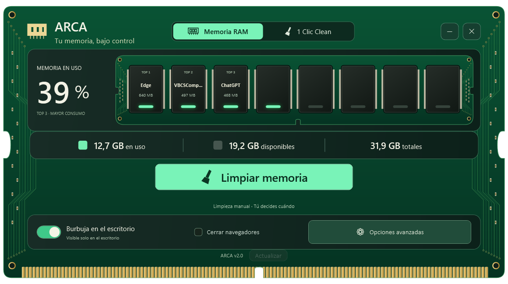

# ARCA

**Another RAM Cleaner Application** — utilidad gratuita para Windows con limpieza manual de RAM y mantenimiento mediante **1 Clic Clean**.

Basada en [Windows Memory Cleaner](https://github.com/IgorMundstein/WinMemoryCleaner), de Igor Mundstein. ARCA es una versión modificada independiente bajo GPL-3.0.


## Descargar y ejecutar

Descarga el portable desde [Releases](https://github.com/Faviogames/ARCA/releases/latest), extráelo y abre `ARCA.exe`. Conserva `nunit.framework.dll` junto al ejecutable: el proyecto heredado incluye sus pruebas en el ensamblado. Cierra la versión anterior desde la bandeja antes de abrir una nueva.

Entrega local: `releases/ARCA-v2.0-portable.zip` y `releases/ARCA-v2.0-source.zip`. Los paquetes se distribuyen como archivos de release, no como binarios dentro del código Git.

ARCA abre sin pedir administrador. La limpieza completa de RAM, los temporales del sistema, el registro, los dispositivos desconectados y Extrema solicitan autorización de Windows al ejecutarse. Un auxiliar de la misma aplicación realiza la operación y termina; no se instala ningún servicio. Cancelar el aviso cancela esa operación. Las cachés del usuario y la papelera pueden limpiarse sin elevar la app.

La autorización debe hacerse con la misma cuenta de Windows que abrió ARCA; no se admite usar las credenciales de otra cuenta para limpiar su perfil. Si la app se abre manualmente como administrador, mantiene esos permisos durante esa sesión.

En **Memoria RAM → Opciones avanzadas**, activa **Iniciar con Windows** para crear un acceso directo en la carpeta Inicio de tu usuario. Al iniciar sesión ARCA se abre en la bandeja; abrirla a mano siempre muestra la ventana. Arrancar ARCA no ejecuta ninguna limpieza. Conserva el portable en una ubicación estable; si lo mueves, desactiva y vuelve a activar esta opción desde la nueva ubicación.

En la misma sección, **Idioma** cambia la interfaz entre español e inglés al momento y recuerda la elección.

## Funciones

- **RAM:** uso físico, top 3 por consumo, limpieza manual y exclusiones.
- **Burbuja circular:** aparece al minimizar u ocultar ARCA y volver al escritorio; se oculta al activar otras aplicaciones, incluidos juegos en ventana. Clic para limpiar RAM, arrastre y menú contextual.
- **Temporales:** temporales del usuario/Windows, informes de errores, volcados antiguos y accesos directos rotos. Los accesos se envían a la papelera.
- **Cachés:** navegadores y Discord cerrados, INetCache y miniaturas. Conserva historial, cookies, contraseñas, marcadores y sesiones.
- **Registro:** reglas acotadas para referencias a programas inexistentes, con exportación previa de claves y restauración.
- **Dispositivos desconectados:** registros no presentes de todas las clases de Windows, sin antigüedad mínima; conserva los paquetes de controladores, comprueba la desconexión antes de retirar y verifica que el registro desapareció.
- **Papelera:** vaciado opcional.
- **Extrema:** shaders de GPU, restos de Windows Update, optimización de distribución y vaciado de la caché DNS. Los juegos necesitan reconstruir los shaders después. También conserva el historial.

Se recuerdan las categorías. La primera ejecución ofrece vista previa; después puede limpiarse con un clic. Hay cancelación e informes locales; un fallo no detiene las demás tareas.

La casilla opcional «Cerrar navegadores» pertenece a la limpieza de RAM y fuerza su cierre cuando se solicita esa limpieza; puede perderse trabajo sin guardar. El mantenimiento de cachés omite los navegadores abiertos.

## Versión 2.0 / Version 2.0

El ejecutable compilado y el portable se llaman **ARCA.exe**. El pie de la interfaz muestra **ARCA v2.0**. El acceso directo de inicio existente se actualiza a la ubicación actual al abrir esta versión.

Se retira la casilla «Actualizar siempre». ARCA consulta GitHub al abrir y cada 24 horas. **Actualizar** se ilumina en rojo y se habilita solo cuando encuentra una versión más reciente. La descarga, instalación y reinicio empiezan únicamente al pulsarlo. Si no hay novedades o no se pudo comprobar, permanece apagado y deshabilitado; la ayuda explica el estado. La preferencia antigua ya no autoriza instalaciones automáticas.

The executable is now named **ARCA.exe**, including its internal assembly identity. The footer displays **ARCA v2.0**. **Update** glows red and becomes clickable only after finding a newer release. Background checks never install updates automatically; click Update to download, install and restart. The disabled button tooltip explains the current state.

Spanish and English are available under **Advanced options → Language**. Windows startup opens ARCA in the tray. Weekly cleaning is still pending in [docs/TODO.md](docs/TODO.md).


## Compilar y probar

Requisitos: Windows 10/11, .NET SDK 10 y NuGet CLI en PATH, o variable `NUGET` con la ruta a `nuget.exe`. El proyecto usa C# y WPF sobre .NET Framework 4.0; las referencias y analizadores se restauran desde `src/packages.config`.

```powershell
powershell.exe -NoProfile -ExecutionPolicy Bypass -File build/build.ps1
powershell.exe -NoProfile -ExecutionPolicy Bypass -File build/test.ps1
```

Con paquetes ya restaurados, añade `-SkipRestore` al primer comando. El resultado es `src/bin/Release/ARCA.exe`; el portable conserva ese mismo nombre.

Las pruebas focalizadas usan datos de ensayo y no limpian la RAM del usuario, cierran sus navegadores ni retiran dispositivos reales. La suite heredada completa no está certificada. Consulta [docs/VALIDATION.md](docs/VALIDATION.md).

Las operaciones elevadas, retirada real de USB, restauración del registro y escenarios con varios monitores/juegos deben comprobarse en el equipo de destino. Más RAM libre o menos caché no garantizan más FPS. Informes y respaldos: `%LOCALAPPDATA%\ARCA`.

Se mantienen la configuración y la exclusión de instancia originales: no ejecutes ambas variantes a la vez. No hay actualización automática desde el proyecto original.

## Licencia y créditos

GPL-3.0. Consulta [LICENSE](LICENSE) y [THIRD_PARTY_NOTICES.md](THIRD_PARTY_NOTICES.md). No se hereda la firma del autor original. Los iconos se generaron para ARCA y están en `src/Resources/Images/Clean/`.
